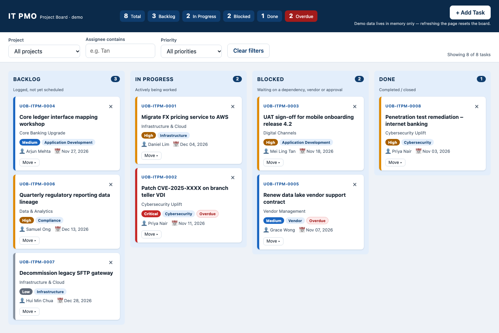

# IT PMO Project Board

A single-file Kanban board for an IT PMO team (demo/training tool). Vanilla HTML, CSS and JS, with no build step and no dependencies.

## Features
- Four columns: Backlog, In Progress, Blocked, Done
- Drag and drop, or the keyboard "Move" menu
- Filter by project, assignee and priority
- Add Task form with an email notification
- Overdue highlighting and live summary counts

## Run locally
Open `index.html` in a browser. Demo data lives in memory only, so refreshing the page resets the board.

## Screenshot
`docs/screenshot.png` is captured with Playwright (1440px wide, full page).
